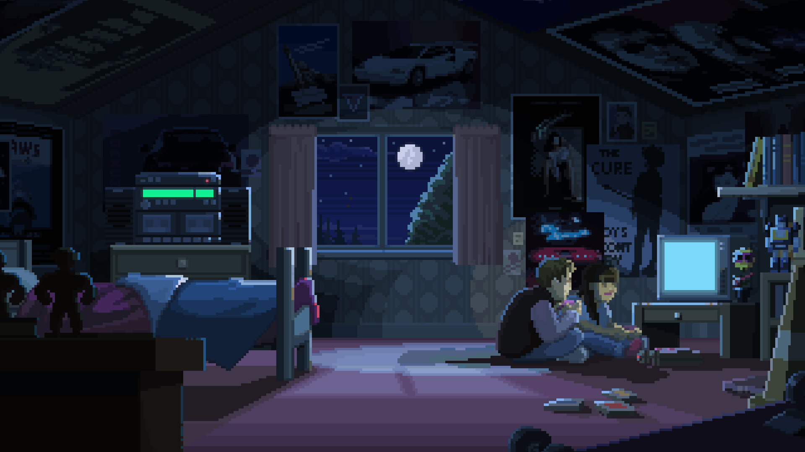
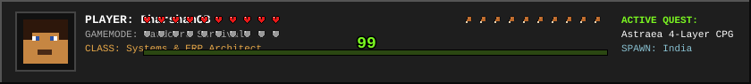
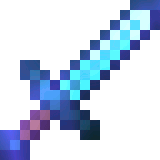
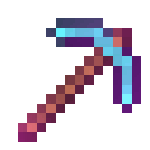
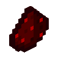
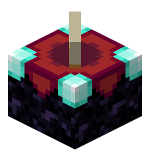
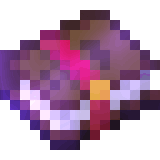
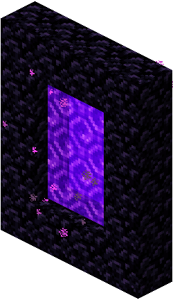
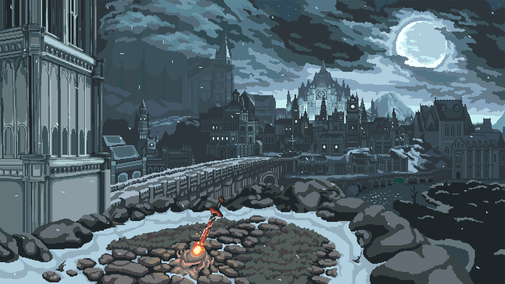

<div align="center">

<!-- Cozy Pixel Art Base Header -->


<!-- Pixel Art Press Start 2P Typing HUD -->
<a href="https://github.com/DharshanOB">
  
</a>

<!-- Minecraft Status Bar: Hearts, Armor, Food & XP Level 99 -->


</div>

---

### Inventory // Equipped Gear

<div align="center">

| <br>**Python** | <br>**C++ / LLVM** | <br>**ERPNext** | <br>**AST / CPG** | <br>**TypeScript** | <br>**PEPPOL** | <br>**Linux** |
| :---: | :---: | :---: | :---: | :---: | :---: | :---: |

</div>

---

### Legendary Drops // Signature Builds

```
+-----------------------------------------------------------------------------------------+
| [ITEM: ASTRAEA]                                                          [RARITY: MYTHIC]
| 4-layer code indexer & AI reviewer unifying Tree-sitter AST, cross-file call graphs,    |
| LLVM SSA intermediate representation, and ELF/DWARF disassembly.                        |
| Source: https://github.com/DharshanOB/astraea                                           |
+-----------------------------------------------------------------------------------------+
| [ITEM: PEPPOL EDOCUMENT]                                                   [RARITY: RARE]
| European B2B e-invoicing access point integration for Frappe with compliant UBL XML.    |
| Source: https://github.com/DharshanOB/EDocument_integration_extention                   |
+-----------------------------------------------------------------------------------------+
| [ITEM: CAMPUS ERP]                                                     [RARITY: UNCOMMON]
| Institutional operating layer built on Frappe Education and ERPNext.                    |
| Source: https://github.com/DharshanOB/campus                                            |
+-----------------------------------------------------------------------------------------+
| [ITEM: AMAZON CONNECTOR]                                               [RARITY: UNCOMMON]
| Real-time SP-API order, inventory, and catalog sync pipeline for ERPNext.               |
| Source: https://github.com/DharshanOB/Amazon-connector                                  |
+-----------------------------------------------------------------------------------------+
```

---

### World Telemetry // HUD

<div align="center">

<table border="0">
  <tr>
    <td align="center" width="50%">
      <a href="https://github.com/DharshanOB">
        
      </a>
    </td>
    <td align="center" width="50%">
      <a href="https://github.com/DharshanOB">
        
      </a>
    </td>
  </tr>
</table>

<picture>
  <source media="(prefers-color-scheme: dark)" srcset="https://raw.githubusercontent.com/DharshanOB/DharshanOB/output/github-contribution-grid-snake-dark.svg">
  <source media="(prefers-color-scheme: light)" srcset="https://raw.githubusercontent.com/DharshanOB/DharshanOB/output/github-contribution-grid-snake.svg">
  
</picture>

</div>

---

### Campfire // Rest Area

<div align="center">



<br><br>

```
   ___________________________________________
  /                                           \
 |   COORDINATES: India (Survival Realm)       |
 |   COMMUNICATION: quietrays@gmail.com        |
 |   STATUS: Sitting by the cozy fire          |
  \___________________________________________/
                     ||
                     ||
```

<p align="center">
  <a href="mailto:quietrays@gmail.com">
    
  </a>
  <a href="https://github.com/DharshanOB">
    
  </a>
  <a href="https://linkedin.com">
    
  </a>
</p>

</div>
