<div align="center">

<!-- Cozy Minecraft Base Banner (Custom Animated Vector SVG) -->


<!-- Pixel Art Press Start 2P Typing HUD -->
<a href="https://github.com/DharshanOB">
  
</a>

<!-- Minecraft Status Bar: Hearts, Armor, Food & XP Level 99 -->


<br>

<!-- Cozy World Telemetry Badges -->
<p align="center">
  
  
  
  
</p>

</div>

---

### Character Data // Player Log

```yaml
[PLAYER_PROFILE]
  Player: DharshanOB
  Spawn_Point: India
  Current_Biome: Deep Systems & Compilers
  Level: 99
  Enchantments:
    - Resilient Architecture IV
    - Deep Program Comprehension V
    - High-Throughput Optimization III
  Active_Buffs:
    - Speed II (FastAPI & Microservices)
    - Strength III (LLVM IR Lowering & AST Slicing)
    - Haste IV (Automated Frappe Workflows)
  Guild_Mantra: "Grounded representations over superficial diffs; resilient architectures over quick fixes."
```

- **Flagship Build — [Astraea](https://github.com/DharshanOB/astraea):** Creator of a 4-layer code indexer, semantic graph analyzer, and AI code reviewer uniting syntax (Tree-sitter), cross-file Code Property Graphs (SCIP/CPG), compiler IR lowering (clang/rustc to LLVM SSA), and machine-code disassembly (lief/capstone + DWARF metadata).
- **Enterprise Redstone Architecture:** Deep experience building resilient **Frappe / ERPNext** systems, including [Peppol Access Point e-invoicing integrations](https://github.com/DharshanOB/EDocument_integration_extention), automated multi-channel seller pipelines ([Amazon Connector](https://github.com/DharshanOB/Amazon-connector)), and institutional ERP layers ([Campus](https://github.com/DharshanOB/campus)).
- **Low-Level Mining & Performance:** Linux kernel tuning, compiler intermediate representation analysis, bytecode execution inspection, and zero-waste memory optimization.
- **AI Agent Automation:** Engineering bounded tool-use pipelines, MCP (Model Context Protocol) servers, and context-aware coding assistants.

---

### Hotbar // Equipped Weapons & Tools

| Slot 1 | Slot 2 | Slot 3 | Slot 4 | Slot 5 | Slot 6 | Slot 7 | Slot 8 | Slot 9 [Offhand] |
| :---: | :---: | :---: | :---: | :---: | :---: | :---: | :---: | :---: |
| **Diamond Sword** | **Enchanted Bow** | **Netherite Pick** | **Redstone Core** | **Anvil & Forge** | **Crafting Table** | **Ender Chest** | **Golden Apple** | **Totem of Undying** |
| `Python` | `TypeScript` | `C / C++ & Rust` | `Frappe / ERPNext` | `Postgres / MariaDB` | `LLVM & AST` | `Docker & Linux` | `Kernel Tuning` | `PEPPOL / CI-CD` |

<div align="center">

<p>
  
</p>

<p>
  
  
  
  
  
</p>

</div>

---

### Crafting Table // Signature Builds

| Recipe | Ingredients | Crafted Output & Highlights |
| :--- | :--- | :--- |
| **[`Astraea`](https://github.com/DharshanOB/astraea)** | `Tree-sitter AST` + `SCIP CPG` + `LLVM SSA IR` + `DWARF` | **4-Layer Code Property Graph & AI Code Reviewer**<br>Unifies structural syntax, call graphs, compiler lowering, and binary disassembly to feed grounded context to AI coding agents. |
| **[`EDocument_integration_extention`](https://github.com/DharshanOB/EDocument_integration_extention)** | `Frappe Framework` + `PEPPOL Network` + `UBL XML` | **Enterprise Peppol Access Point Provider**<br>Belgian and European compliant electronic invoicing pipeline with automated schema validation and direct network transmission. |
| **[`campus`](https://github.com/DharshanOB/campus)** | `Frappe Education` + `ERPNext` + `Academic Layer` | **Higher-Education Management ERP**<br>Complete institutional operating layer for colleges and universities managing admissions, academics, and administration. |
| **[`Amazon-connector`](https://github.com/DharshanOB/Amazon-connector)** | `Amazon SP-API` + `Frappe Sync Engine` + `Python` | **Real-Time E-Commerce Connector**<br>Automated inventory sync, order pipeline, and catalog reconciliation between Amazon marketplaces and ERPNext. |
| **[`rewrite`](https://github.com/DharshanOB/rewrite)** | `TypeScript` + `Modular Architecture` + `High Perf` | **Modern Full-Stack Web Engine**<br>Lightweight, high-performance web tooling and application foundation. |

---

### Advancements Unlocked

```
+-----------------------------------------------------------------------------------------+
| [ADVANCEMENT UNLOCKED] Master of the Forge                                              |
| Lowered high-level code through Tree-sitter, LLVM SSA intermediate representation,      |
| and machine assembly with DWARF line alignment.                                         |
+-----------------------------------------------------------------------------------------+
| [ADVANCEMENT UNLOCKED] The Peppol Highway                                               |
| Built compliant European B2B e-invoicing pipelines connecting ERPNext to Peppol nodes.  |
+-----------------------------------------------------------------------------------------+
| [ADVANCEMENT UNLOCKED] Redstone Architect                                                |
| Engineered custom applications and multi-channel connectors on the Frappe framework.     |
+-----------------------------------------------------------------------------------------+
```

---

### World Telemetry // GitHub HUD

<div align="center">

<table border="0">
  <tr>
    <td align="center" width="50%">
      <a href="https://github.com/DharshanOB">
        
      </a>
    </td>
    <td align="center" width="50%">
      <a href="https://github.com/DharshanOB">
        
      </a>
    </td>
  </tr>
  <tr>
    <td align="center" colspan="2">
      <a href="https://github.com/DharshanOB">
        
      </a>
    </td>
  </tr>
</table>

</div>

---

### Contribution Grid Snake // Mob Trail

<div align="center">
  <picture>
    <source media="(prefers-color-scheme: dark)" srcset="https://raw.githubusercontent.com/DharshanOB/DharshanOB/output/github-contribution-grid-snake-dark.svg">
    <source media="(prefers-color-scheme: light)" srcset="https://raw.githubusercontent.com/DharshanOB/DharshanOB/output/github-contribution-grid-snake.svg">
    
  </picture>
</div>

---

### Wooden Signpost // Safe Travels

<div align="center">

```
   ___________________________________________
  /                                           \
 |   COORDINATES: India (Survival Realm)       |
 |   COMMUNICATION: quietrays@gmail.com        |
 |   STATUS: Sitting by the cozy campfire      |
 |   BUILDING: Systems, Compilers & ERP Apps   |
  \___________________________________________/
                     ||
                     ||
                     ||
```

<p align="center">
  <a href="mailto:quietrays@gmail.com">
    
  </a>
  <a href="https://github.com/DharshanOB">
    
  </a>
  <a href="https://linkedin.com">
    
  </a>
</p>

<p align="center">
  <i>Crafted block by block with code and redstone. Take a seat by the fire.</i>
</p>

</div>
